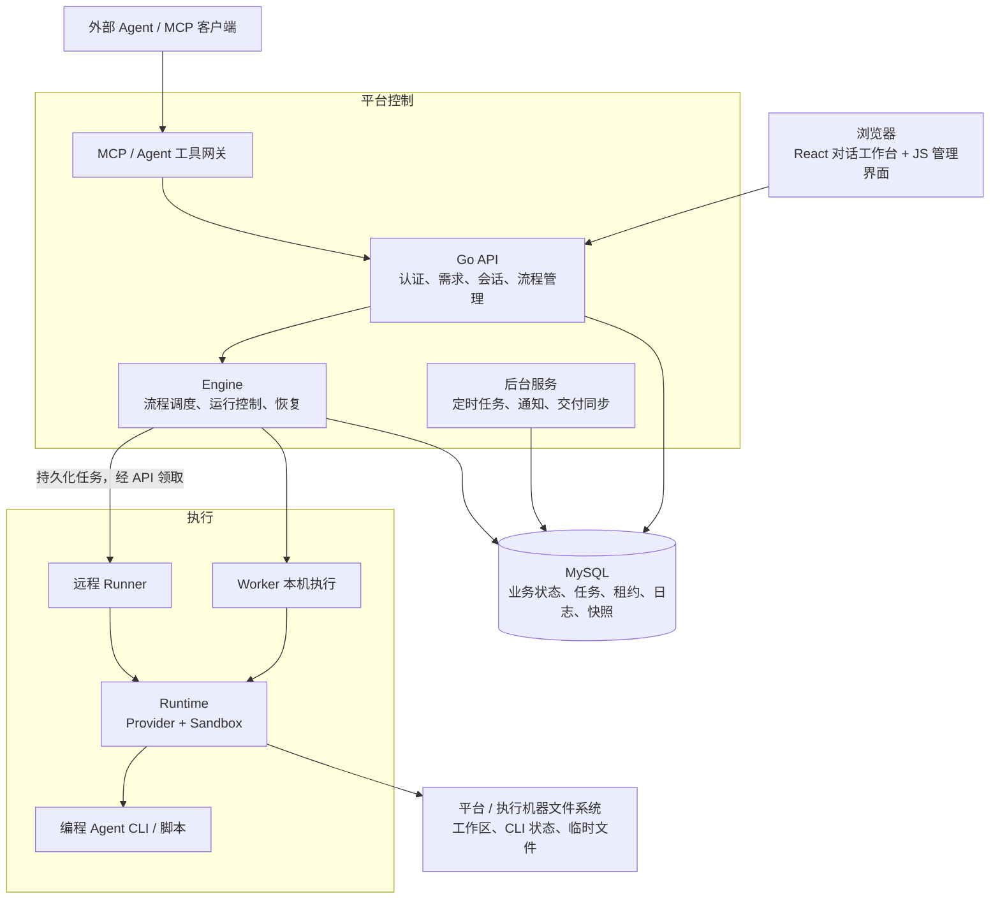
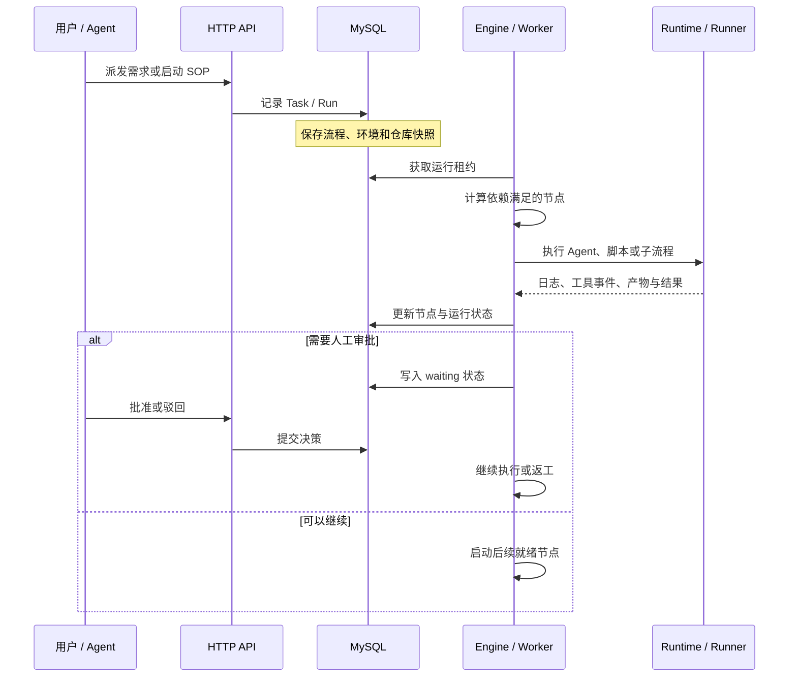

# LoopForge 仓库架构分析

分析日期：2026 年 11 月 20 日。

LoopForge 的架构可以概括为：**以 MySQL 为协调中心的模块化单体，支持将流程调度与实际执行拆到独立 Worker 和 Runner 上。**

它围绕长时间运行的 AI 开发任务组织系统：任务需要跨进程执行、等待人工审批、保留工作区、处理断线恢复，并把结果关联回需求与 Git 交付。理解架构的重点在于控制、执行、持久化三者如何协作。

本分析基于当前仓库源码。性能和扩展能力部分属于架构判断，不代表压力测试或实际部署验证结果。

## 1 整体结构与进程部署

控制与执行可以分离，业务模块仍在同一套 Go 工程中。



图中的模块是逻辑职责。默认部署把 API、Engine 和本机执行能力放在一个平台进程里，需要扩展时再拆开。

| 进程角色 | 主要职责 |
| --- | --- |
| `-role all` | API 与流程执行合在一起，适合默认部署 |
| `-role api` | 提供页面、接口及相关后台能力，关闭 SOP 的本机执行 |
| `-role worker` | 领取和推进运行，执行节点，提供内部控制接口 |

`agentflow-runner` 是独立执行端，通过平台 API 接收任务，适合连接开发者机器或执行池。Worker 负责平台侧流程推进，Runner 负责远程机器上的任务执行，二者职责不同。

默认 Compose 是 MySQL 与 Platform，没有要求部署 Redis、Kafka 或专用任务队列。API 与 Worker 分离时需要共享 MySQL，并配置控制地址、服务凭据和执行环境可达的平台地址。

源码入口：[部署配置](../compose.yaml)、[平台进程入口](../cmd/agentflow/main.go)、[Runner 入口](../cmd/agentflow-runner/main.go)。

## 2 代码分层与依赖关系

| 模块 | 核心职责 | 依赖特点 |
| --- | --- | --- |
| `internal/domain` | 需求、流程、角色、运行、Runner 等对象与基础行为 | 各模块共用的数据契约 |
| `internal/httpapi` | HTTP 路由、认证授权、参数校验，以及部分业务编排 | 直接调用 Repo、Engine 和集成服务 |
| `internal/engine` | SOP 调度、运行状态、失败恢复、工作区生命周期 | 直接依赖 `repo.Store` 和 Runtime |
| `internal/runtime` | CLI 配置生成、进程启动、输出解析、沙箱和凭据绑定 | 通过 Provider、Sandbox 抽象适配执行差异 |
| `internal/runner` | 远程执行机器的任务、工作区、控制与回传 | 复用 Runtime |
| `internal/repo` | MySQL 持久化、事务、租约、状态更新、分析查询 | 按业务领域拆 Repo |
| `internal/tracker` 等 | Git 托管、知识库、通知、定时任务、预览 | 部分模块采用窄接口隔离依赖 |

这是按业务模块划分、局部分层的架构。流程执行集中在 Engine，但需求状态同步、会话生成和部分后台协调仍位于 `httpapi` 中；Repo 也承担部分领域规则。业务逻辑没有全部经过统一 service 层。

`internal/application` 目前主要是 HTTP/MCP 共用的操作清单，并非覆盖所有业务的应用服务层。

Repo 与 handler 都采用组合装配：

- `Store` 组合 `CatalogRepo`、`IssuesRepo`、`RunsRepo`、`AssistantRepo` 等领域 Repo。
- `Server` 装配各领域 handler。
- 领域之间通过显式指针或回调协作。

这样的结构明确了方法归属。不过，handler 共用的 `deps` 仍能访问完整 `Store` 和 `Engine`，领域隔离主要依赖代码约定与审查，编译期约束较弱。

源码入口：[Repo 装配](../internal/repo/repo.go)、[Handler 装配](../internal/httpapi/server.go)、[操作清单](../internal/application/operations.go)。

## 3 业务模型与执行链路

| 对象 | 作用 |
| --- | --- |
| `Project` | 组织成员、仓库与项目资产 |
| `Issue` | 原始需求或缺陷，记录负责人、状态与交付关联 |
| `Task` | 需求派发记录，同时承担跨实例幂等职责 |
| `WorkflowDefinition` | SOP 定义，描述节点、依赖、运行环境与版本 |
| `AgentDefinition` | 可复用角色，描述提示词、模型、工具与验证要求 |
| `Run` / `NodeRun` | 一次实际执行，以及每个节点的执行状态 |
| `RunnerTask` | 派发到远程执行机器的持久化执行任务 |
| `Artifact` | 方案、评审报告、测试报告、源码或预览包等产物 |

SOP 的核心是持久化的流程状态机与依赖图调度。一次执行的大致链路如下。



### 3.1 运行使用定义快照

`Run` 保存 `WorkflowSnapshot`，其中可以冻结沙箱、Dockerfile 和环境配置。模板后续修改不会直接改变正在执行的流程，有利于重试与历史追溯。

### 3.2 节点按依赖就绪执行

独立分支可以并发，一个分支完成后即可解锁自己的下游。正常依赖图之外，引擎还处理审批、重试、驳回返工和子 SOP。

### 3.3 一个运行共享工作区

Agent、脚本和验证步骤通常操作同一套文件；子 SOP 也可以共享父流程工作区。这减少了代码与产物交接成本，但流程节点之间没有依赖关系，不等于它们对文件系统的修改天然互不干扰。并行角色修改相同文件时，仍需要流程设计或执行策略协调。

### 3.4 对话复用底层执行设施

对话工作区通过 `Run.kind=workspace` 与 SOP 运行区分。它没有 SOP 节点图，不参与普通 SOP 调度，却能复用工作区、Runner、快照、租约和产物管理。这样可以共享执行基础设施，同时保留两种交互方式的语义。

源码入口：[运行模型](../internal/domain/run.go)、[流程模型](../internal/domain/workflow.go)、[运行启动](../internal/engine/run_start.go)、[节点调度](../internal/engine/node_execute.go)、[共享执行环境](../internal/engine/run_environment.go)。

## 4 分布式协调与恢复

数据库保存持久状态，通知通道降低操作延迟。不同控制对象分别解决不同问题。

| 对象 | 解决的问题 |
| --- | --- |
| `Task` | 同一个需求派发请求的幂等记录 |
| `Run` 租约 | 当前由哪个平台实例推进流程 |
| 执行代次 `Generation` | 防止旧执行实例继续提交过期状态 |
| `RunnerTask` 租约 | 远程任务由哪台执行机器领取与执行 |
| 工作区租约 | 协调会话、快照和工作区使用 |

Worker 定期扫描可恢复运行并尝试领取，当前循环间隔为两秒。运行过程中持续续租；续租失败或发现控制请求时，执行会中止并进入相应收尾路径。

Runner 只需要主动向平台建立连接：

- HTTPS 用于注册、领取任务、续租和结果交互。
- WebSocket 用于低延迟控制与推送。
- 控制意图还保存在数据库中，连接中断后可通过续租等路径重新获得。

这种设计允许通知丢失后重新读取持久状态。但租约和幂等记录不代表所有外部副作用都只发生一次。推送代码、创建 PR、调用外部 API 等操作，仍需各自的幂等与恢复策略。

运行订阅还通过数据库 revision 轮询补偿跨进程更新，当前轮询间隔为 500 毫秒。随着订阅数量增加，应关注数据库查询开销。

源码入口：[任务幂等](../internal/repo/tasks.go)、[运行租约](../internal/repo/runs.go)、[恢复扫描与订阅](../internal/engine/run_state.go)、[运行控制](../internal/engine/run_control.go)、[Runner 通信](../internal/runner/daemon.go)、[远程派发](../internal/engine/runner_dispatch.go)。

## 5 持久化与文件状态

数据层使用关系字段与 JSON 混合存储。很多实体采用以下结构：

```text
主键、筛选字段、锁定字段、时间字段 + JSON payload
```

`Run` 对状态、租约、代次、revision 等关键字段做显式列设计，并将流程快照、仓库信息等保存为 JSON；节点、事件、日志和其他子资源有各自的表。

| 收益 | 代价 |
| --- | --- |
| 增加定义字段比较方便 | 复杂筛选、统计需要 JSON 查询或额外投影 |
| 容易保留完整历史快照 | 数据库约束难以覆盖所有内部关系 |
| 领域对象读写直观 | payload 与显式字段需要保持一致 |

工作区快照可以存入 MySQL，较大归档使用分块存储。因此 MySQL 同时承担业务数据、任务协调、日志与快照归档负载。部署简单，但数据库容量、I/O、备份时间和保留策略会成为规模增长后的重点。

备份也需要覆盖文件系统：活跃工作区和部分 CLI 会话状态位于平台或 Runner 本地。“MySQL 是唯一生产数据库”不意味着磁盘无状态。

迁移方面，应用启动仅做增量 DDL；数据迁移与 seed 由显式 SQL 和安装、升级流程处理。这让数据变更更可控，也要求运维关注版本与迁移脚本的匹配。

源码入口：[表模型](../internal/repo/models.go)、[JSON 读写](../internal/repo/payload.go)、[工作区快照](../internal/repo/workspace_checkpoints.go)、[快照分块](../internal/repo/workspace_checkpoint_chunks.go)、[数据库连接与初始化](../internal/repo/repo.go)。

## 6 CLI 与协议扩展边界

Runtime 的两个主要抽象是：

- `Provider`：负责一种编程 CLI 的配置、启动参数、输出协议和执行需求。
- `Sandbox`：提供工作区、执行命令和关闭环境的统一接口。

新增 CLI、增加执行环境、修改流程调度，可以落在相对不同的位置。远程 Runner 也复用 Runtime，减少了本机和远程两套执行实现之间的重复。

HTTP/MCP 通过统一操作清单复用业务入口。MCP 调用可以通过 `LocalInvoker` 构造内部 HTTP 请求，再进入同一套 API handler，从而复用鉴权、参数校验和业务行为。远程 MCP 桥接则通过 HTTP 调用平台。

代价是 MCP 与 HTTP 的路径、请求体和 handler 耦合较紧，也说明 HTTP 层目前承载较多业务入口职责。

预览服务展示了另一种较清晰的隔离方式：通过 `Host` 接口回调 Engine，预览包不直接导入 Engine。这种窄接口方式可以作为后续组件拆分的参考。

源码入口：[Provider 接口](../internal/runtime/provider.go)、[Sandbox 接口](../internal/runtime/runtime.go)、[MCP 调用桥接](../internal/mcpserver/server.go)、[预览服务接口](../internal/preview/service.go)。

## 7 前端与独立产品边界

前端由两套实现组成：

| 目录 | 技术与职责 |
| --- | --- |
| `chatbot/` | React 与 Vite，承载对话工作台、工作区、产物和运行面板 |
| `web/` | 原生 JavaScript 管理界面，承载需求、SOP、审批、资产、统计等页面 |

前端静态资源通过 Go `embed` 打包，可由平台服务统一提供。两套前端便于各自演进，但会增加组件、API 契约和交互一致性的维护成本。

`local/` 是旧版独立工作流产品，有 Classic、Portable 两套资产体系，与平台运行时分开维护。平台开发通常从根目录 Go 工程开始；修改 Local 时应遵循其独立说明，不混用两套工作流资产。

仓库保留 `agentflow` 模块名、二进制名和 `AGENTFLOW_` 环境变量，以维持兼容性。

源码入口：[前端资源嵌入](../web/embed.go)、[对话前端依赖](../chatbot/package.json)、[Local 说明](../local/README.md)、[总体架构说明](architecture.md)。

## 8 架构评价与演进建议

这套架构适合可信团队部署一个控制平台，连接若干执行机器，统一管理 AI 研发流程。

主要优势：

- 默认部署组件少，容易安装和排查。
- 租约、执行代次、快照、恢复和人工审批围绕长任务设计。
- CLI 与沙箱适配已有抽象，方便扩展执行能力。
- 需求、对话、SOP、工作区和交付复用底层设施，减少多套系统重复建设。

默认 Docker 方案使用宿主 Docker socket，其部署边界是可信团队，不适合作为不可信多租户隔离边界。

后续维护建议优先关注以下问题。

| 关注点 | 当前依据 | 建议方向 |
| --- | --- | --- |
| 业务编排位置分散 | handler、Engine、Repo 都承担部分规则 | 将会话执行、需求派发、状态收敛逐步抽成明确服务 |
| Engine 职责较宽 | 同时处理调度、Git、工作区、恢复、预览和远程执行 | 按职责建立内部组件，保留统一运行协调入口 |
| 数据库负载集中 | 业务、租约、轮询、日志、快照共用 MySQL | 先做容量与查询观测，再决定是否拆分归档和通知 |
| 并行共享工作区 | 分支可并发执行并操作同一目录 | 明确文件所有权或对冲突步骤串行化 |
| 前端维护体系分为两套 | React 对话工作台与原生 JS 管理界面并存 | 优先统一 API 类型、组件契约和设计基础 |
| API 横向扩展需要额外验证 | 会话进程、连接 Hub 和部分任务状态保存在进程内 | 逐项验证重连、路由、实例切换与恢复能力 |

建议优先做进程内部的职责拆分和契约收紧。现阶段通过 Worker、Runner 已能分散执行负载；直接把各领域拆成独立服务，会让原本可以在同库事务内完成的状态协调跨越网络，增加恢复与一致性成本。

## 9 开发者阅读路径

建议沿着“创建需求 → 派发 SOP → 执行脚本 → 人工审批 → 查看产物”阅读完整链路，再看真实模型与远程 Runner。

1. 从 `internal/domain` 理解 `Issue`、`Task`、`WorkflowDefinition`、`Run` 和 `RunnerTask` 的区别。
2. 从 `cmd/agentflow/main.go` 与 `internal/httpapi/server.go` 理解进程和接口装配。
3. 从 `internal/engine/run_start.go` 理解校验、快照与执行准备。
4. 从 `internal/engine/node_execute.go` 理解依赖调度，再看结果处理、控制与恢复。
5. 从 `internal/runtime/provider.go` 与 `internal/runtime/runner.go` 理解 CLI 启动和输出回传。
6. 对照 `internal/runner` 理解远程执行、租约与工作区操作。
7. 结合 [E2E 说明](../e2e/README.md) 查看业务链与对应验收用例。

修改代码时应遵守根目录 [AGENTS.md](../AGENTS.md) 的领域归属、迁移和前端约定，并保持部署适配与平台核心隔离。
